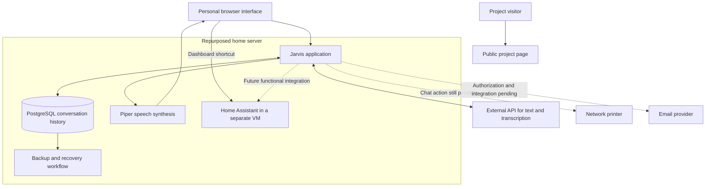

# Jarvis development log: November 5–10, 2026

*Published November 14, 2026. Dates use Europe/Oslo.*

Over these six days, Jarvis progressed from a prepared database to a conversational assistant with persistent chat history, browser voice input, local speech synthesis, a public project page, and the first steps toward household integrations.

The server is still the rescued Packard Bell that started this project. The work focused on adding useful capabilities to the existing setup and checking each step before moving on.

This retrospective was reconstructed from the development conversations, recorded test results, screenshots, and implementation files reviewed for this update. **Tested** means a result was documented at the time; **reported working** means I confirmed it during development; **prepared** means code or setup work existed but a complete functional test was still outstanding. None of those labels is a claim that every component has been freshly retested on the publication date.

## November 5 — Preparing persistent memory

### What advanced

PostgreSQL 17 and the database for Jarvis were already in place by the end of this day's work. We checked the database access and the ability to create the application tables before changing its structure.

The next step was a logical database backup. The recorded result showed that the backup completed, its archive index could be read, and a SHA-256 checksum was calculated. That gave us a known starting point before building the conversation schema.

### Evidence and status

- **Confirmed in the development record:** PostgreSQL was available and database access had been checked.
- **Tested:** a local logical backup was created and its archive structure checked.
- **Still pending at this point:** verification of the external copy, conversation tables, and application integration.

### Why it mattered

The goal was to give Jarvis a place to keep conversations across restarts. A database alone would not provide useful memory, but it established the foundation for storing and retrieving real exchanges.

## November 6 — Making memory work with the chat

### What advanced

We created the conversation and message structures and connected them to the existing FastAPI application. Python database access was tested, followed by the ability to create a conversation, store messages, and retrieve them.

The development record includes a persistence test across a restart and a restore into a separate test database. A saved message was recovered from an external backup. This was an important distinction: we tested recovery of useful data, rather than treating the existence of a backup file as sufficient.

The backup workflow was extended to include logical PostgreSQL backups, external transfer, integrity comparison, and retention. Manual retention checks completed successfully. Observing the subsequent scheduled runs remained a separate task.

We also connected the conversation flow to OpenAI's API. The recorded configuration selected GPT-6 Astra, and test responses showed token usage. The model then used stored conversation history, and the exchange was saved back to PostgreSQL.

The chat was tested from the Windows browser. The headset microphone was also checked, and audio dependencies were prepared for the next day's voice work.

### Evidence and status

- **Tested:** database connection, conversation creation, message storage, and retrieval.
- **Tested:** persistence after restart and recovery of a message from an external backup.
- **Tested:** API-generated replies using conversation history, with usage recorded.
- **Tested:** a browser conversation from Windows.
- **Prepared:** the audio prerequisites; the microphone-to-Jarvis transcription flow was not yet complete.

### Why it mattered

Jarvis could now continue a conversation using stored history. This was conversational persistence, not yet a system that automatically extracts durable facts, resolves conflicting decisions, or searches every past project discussion.

## November 7 — Adding voice input and improving access

### What advanced

We worked on the browser's recording flow and connected uploaded audio to transcription. The interface was adjusted so text messages and recorded audio could be sent in their appropriate formats.

The voice route was added to the application and checked before a real recording test. Development continued toward speaking through the headset, seeing the transcript, and using it in the existing chat flow. The later project summary records this speak-to-text-to-reply workflow as repeatable.

Cloudflare Tunnel and Access were configured for personal web access. Work also began on associating the signed-in user with an existing conversation, so continuing from another device would not require manually entering a conversation identifier.

The interface still needed refinement during this stage. In particular, the move from the earlier access form to a smoother signed-in experience crossed into the following day's work.

We also prepared public landing-page designs in Spanish and English, with an animated Jarvis sphere and links for following and supporting the project. The GitHub repository became the place to document the build.

### Evidence and status

- **Tested in the record:** application startup and checks around the newly registered voice route.
- **Implemented and subsequently documented as working:** browser dictation feeding the text conversation.
- **Configured in the record:** the personal web-access components.
- **In progress:** the complete sign-in and conversation-resumption experience.
- **Prepared:** the public landing page; its publication and separation from the personal chat were completed in the next stage.

### Why it mattered

Jarvis was becoming usable through an ordinary browser, rather than only through administration tools. It also became easier to explain the project publicly without sharing the personal assistant itself.

## November 8 — Publishing the project and giving Jarvis local voices

### What advanced

We published the public project page using Cloudflare Pages and separated it from the personal chat experience. The landing page introduced the rescued computer, the purpose of Jarvis, and the links to GitHub and project support.

The chat layout was refined for desktop and mobile. The animated sphere, conversation area, and navigation were adjusted to make the interface more coherent.

We reviewed how much conversation history the model actually received. The implementation examined at the time used a bounded recent-history window. That helped explain why saving a conversation does not necessarily mean every earlier correction is included in each new response.

We also prepared a change to provide the current Oslo date and time with each request. The complete response-level check remained something to confirm, rather than assuming that a correct server clock automatically reached the model.

The main voice milestone was **Piper**, running on the Packard Bell. The reviewed screenshot showed four downloaded voice models:

| Language | Piper voice |
|---|---|
| Spanish, Mexico | Claude |
| English, United States | Lessac |
| Norwegian | Talesyntese |
| Russian | Dmitri |

Here, “Claude” is the name of a Piper voice, not a conversational AI provider.

The integration work connected voice previews and spoken replies to Piper. We then prepared automatic language selection so the response could be spoken in the appropriate language without changing a selector for every turn. I reported that the result was working during development.

A hands-free browser update was also prepared. Its design used transcription to recognize “Jarvis,” followed by a short window for continuing the conversation.

### Evidence and status

- **Published and reported working:** the public project page and its separation from the personal chat.
- **Confirmed by a reviewed screenshot:** all four Piper voice models were present.
- **Prepared, with subsequent user confirmation:** Piper integration and automatic language selection.
- **Still requiring a complete repeatable test:** hands-free conversation across multiple turns, browser reopening, and avoiding activation from Jarvis's own voice.
- **Not established:** local wake-word detection.

### Why it mattered

Speech output could now be generated on the home server. Text generation and transcription still used an external API.

That distinction also matters for the hands-free design: when listening is enabled, detected speech can be sent for transcription before the name “Jarvis” is recognized. A reliable local wake-word stage remains a separate improvement.

## November 9 — Printing and a place for connections

### What advanced

We checked the network printer from the Jarvis environment and tested direct PDF printing. An initial attempt failed because the example PDF was unavailable. A purpose-built one-page test document was then used, and the development record reports that the physical page printed.

This demonstrated printing from the server. It did not yet demonstrate a natural-language command that generates and prints a document from the chat.

We designed and prepared the **Connections** page, with entries for:

- Email accounts
- Printers
- Wi-Fi devices
- Bluetooth

The page was given an entry point from the chat. The longer-term design was that each connection should be something a user can add, test, and disconnect, rather than a fixed assumption about my own equipment.

Gmail was selected as the first email provider to work on. API and OAuth preparation progressed, but the final recorded continuation still left server-side completion and account authorization outstanding.

### Evidence and status

- **Reported working after a physical test:** PDF printing from the Jarvis server.
- **Prepared:** the Connections page and its chat navigation.
- **Setup progressed:** Gmail integration prerequisites.
- **Still pending:** a fully authorized Gmail connection and chat-driven printing.
- **Not demonstrated:** device control merely because a Wi-Fi or Bluetooth card appears in the interface.

### Why it mattered

The printer test was the first concrete step toward useful household actions. The Connections page established a home for those capabilities, while keeping the distinction between a visible interface and a working integration.

## November 10 — Adding Home Assistant and reviewing the deployment

### What advanced

We reviewed the existing deployment and its resource allocation before expanding it. The review also revisited service availability, the separation between public presentation and personal use, and backup coverage.

Home Assistant OS was installed in a separate virtual machine under Proxmox. The system information shared during development reported a healthy and supported installation. I completed the initial sign-in and reported that multi-factor authentication was enabled.

A fifth Connections card was prepared for Home Assistant. The link was corrected to match the address that actually worked in the local environment, instead of relying on an assumed default. The subsequent development exchange acknowledged the result positively, although the published file was not independently re-fetched during the later review.

We explicitly separated two different outcomes:

1. Opening the Home Assistant dashboard from Jarvis.
2. Having the Jarvis backend read device states or perform authorized actions through Home Assistant.

The first was the focus of the interface work. The second remained a future integration requiring an end-to-end test.

### Evidence and status

- **Recorded in system information:** Home Assistant OS was running in a virtual machine and reported healthy status.
- **Reported completed:** initial setup and multi-factor authentication.
- **Prepared and acknowledged in the development exchange:** the Home Assistant navigation card.
- **Still pending:** a demonstrated device-state query from the Jarvis chat, followed later by carefully scoped actions.

### Backup clarification from the retrospective

The November 10 review and the November 6 backup work described different management surfaces. An empty backup-job view in the virtualization interface does not by itself prove that a separately scheduled script is absent.

The accurate project status is that backup and restore tests were documented earlier, while recent scheduled execution and coverage of the newly added Home Assistant VM still need to be checked separately. We should preserve that distinction instead of rewriting the earlier successful tests as if they never happened.

## Architecture reached during this period

This is a conceptual overview, not a deployment guide. Dashed connections represent work that still needed functional verification.

## Status at the end of November 10

| Capability | Status supported by the reviewed record |
|---|---|
| Persistent conversations | Storage, retrieval, restart persistence, and a restore test documented |
| Text conversation | External API connected and browser exchange tested |
| Browser voice input | Implemented and documented as repeatable |
| Local speech output | Piper models confirmed; integration and language work reported successful |
| Hands-free interaction | Update prepared; complete repeatable acceptance test still needed |
| Public project presentation | Published, with a separate personal chat experience |
| Direct server printing | Physical test page reported printed |
| Printing from chat | Still to be integrated and demonstrated |
| Gmail | Setup started; complete authorization and use not established |
| Home Assistant | Installation documented; dashboard access added to the interface work |
| Home control through Jarvis | Not yet demonstrated |
| Long-term decision memory | A goal beyond the existing recent-conversation context |

## What comes next

1. Re-test the complete text and voice experience, including two consecutive hands-free turns and language changes.
2. Verify recent scheduled backups and test recovery coverage for both the assistant and Home Assistant.
3. Start the Home Assistant integration with a read-only device-state query from the chat.
4. Complete email authorization before claiming that Jarvis can read mail.
5. Connect the already-tested printing capability to an explicit user request in the chat.
6. Record architecture decisions and corrections in a durable project log, alongside conversation history.

The most useful progress this week was making individual capabilities testable: a saved message recovered after a restart, a restored backup, a spoken input turned into a conversation, and a PDF that reached a real printer. The remaining work is to connect those pieces without claiming more than the tests show.

## About this public record

This entry summarizes the private development record and reviewed artifacts from November 5–10. Original chats, screenshots, transcripts, and operational configurations are not published here. Private addresses, account identifiers, credentials, access instructions, and internal deployment details have been omitted.

This repository documents the project. It should not be treated as a complete source release or a reproducible installer for the running system.

